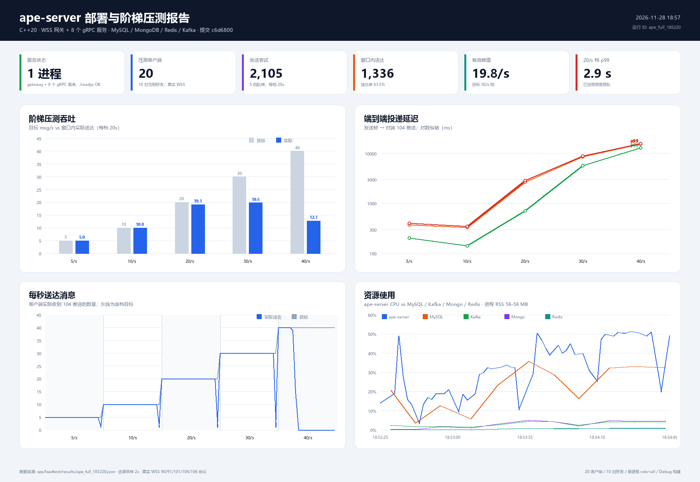

# ape-server 部署与阶梯压测报告

- 运行 ID：`ape_full_185220`
- 报告时间：2026-11-28 18:57（Asia/Shanghai）
- 代码版本：`c6d6800`（清理链路无用方法与字段，添加详细注释）+ 工作区改造
- 宿主机：WSL2 Ubuntu 24.04，16 vCPU / 5.8 GiB RAM
- 部署方式：Docker 依赖（MySQL / MongoDB / Redis / Kafka）+ 源码编译的 `build/main --role=all`（systemd 托管）

## 1. 结论摘要

| 项目 | 结果 |
|---|---|
| 服务 | **1 进程，gateway + 8 个 gRPC 服务全部就绪**，`/healthz`、`/readyz` 返回 OK |
| 压测方式 | 20 个真实 WSS 客户端、10 对互为好友、1:1 单聊 |
| 阶梯 | 5 → 10 → 20 → 30 → 40 msg/s，每档 20 s |
| 稳定区间 | **5–10 msg/s**：p99 ≤ 398 ms，全部送达 |
| 拐点 | **20 msg/s 开始排队**：送达 19.1/s，p99 2.85 s，送达率 95.5% |
| 30 msg/s | 实际 19.8/s，p99 8.84 s，窗口内送达率 66.1% |
| 40 msg/s | 实际 12.7/s，p99 15.61 s，窗口内送达率 31.7% |
| 资源 | ape-server CPU 峰值 51.5%、MySQL 35.8%、Kafka 4.6%；**CPU 不是瓶颈** |
| 落库 | 本次运行新增 **1,734 条** outbox / Mongo 消息；outbox 最终 pending=0、failed=0 |
| 未确认 | 2,206 次发送尝试中 472 条未形成 outbox 记录（过载下未确认），协议层未返回错误码 |

> 结论：当前默认部署（单进程 `role=all`、2 个 OutboxWorker、单机 MySQL/Kafka）在 1:1 单聊下的**舒适吞吐约 10 msg/s，饱和点约 20 msg/s**。超过 20 msg/s 后 outbox 队列迅速堆积，30/40 msg/s 档虽然最终能落库一部分，但端到端延迟达到秒级到十几秒，且出现过载未确认的消息。

## 2. 部署结果

### 2.1 依赖组件

| 组件 | 镜像 / 版本 | 宿主端口 | 状态 |
|---|---|---|---|
| MySQL | `mysql:8.4.9` | 3306 | healthy |
| MongoDB | `mongo:7.0` | 27017 | Up |
| Redis | `redis:7.2-alpine` | 6379 | healthy |
| Kafka | `apache/kafka:4.1.1`（KRaft） | 29092 | Up，`msg_topic` 10 分区 |
| etcd | 系统 `etcd` / 3.5.x | 2379 | healthy |

### 2.2 ape-server

- 启动命令：`/root/ape-server/build/main --role=all`
- systemd 单元：`ape-server.service`，`LimitNOFILE=65535`，失败自动重启
- 环境：`OTEL_SDK_DISABLED=true`（压测期间关闭 OTLP 导出，避免 ES/Grafana 资源干扰）、`HEALTH_PORT=8080`、`SPDLOG_LEVEL=info`
- 端口：WSS 6666；gRPC 50051–50058；健康检查 8080
- 健康检查：`/healthz` → `{"status":"ok"}`；`/readyz` → `{"status":"ready"}`

### 2.3 数据与配置

- MySQL：`ape_auth`，用户 `ape_user/ape_password`；表由服务启动时 `Initialize*` 幂等创建/补齐。
- MongoDB：`IM-System.msg`，root/root。
- Redis：`redis123`。
- Kafka：`localhost:29092`，服务端 producer/consumer 使用 `msg_topic`。
- 为让 10 对客户端可以互发消息，压测前直接向 `friends` 和 `friend_pairs` 写入了 10 对双向好友关系（等价于好友申请/接受后的数据状态）。

## 3. 压测方法

### 3.1 为什么没有直接使用 `test/stress_test.cpp`

项目自带 `test/stress_test.cpp` 仍是旧协议（`auth::AuthResponse`、`SdkWSReq.userid`、`MsgData.sendID string`），与当前 `proto/*.proto`（`AuthRegResponse`、`account uint64`、`sendID uint64`、`SdkWSReq.account`）不一致，直接编译失败；CMake 中该 target 也被注释。

因此本次没有修改原文件，而是按**当前真实 WSS 协议**实现了参数化压测客户端 `ops/loadtest.py`：

1. 通过 WSS type=90 注册、type=91 登录（获取 token，并等待 209/210 登录同步结束）。
2. 直接向 MySQL 写入 10 对双向好友关系。
3. 每档按目标总速率向 20 个客户端轮询分配发送；每个客户端只向自己的配对端发送。
4. 发送 type=101，接收端从 type=104 在线推送中匹配 `clientMsgID`，计算**端到端投递延迟**；收到推送后回 type=106 ACK。
5. 每档 20 s，档间等待 2 s；预热 5 s（20 msg/s）后 drain 10 s，再清零统计，避免预热尾巴污染第一档。

### 3.2 负载参数

| 参数 | 值 |
|---|---|
| 客户端 | 20（10 对） |
| 阶梯 | 5 / 10 / 20 / 30 / 40 msg/s |
| 每档时长 | 20 s |
| 预热 | 5 s @ 20 msg/s + 10 s drain |
| 消息 | 1:1 文本（`sessionType=1`、`contentType=101`） |
| ACK | 每条推送回 type=106 |
| 延迟口径 | 发送帧写到对端收到 104 推送 |

## 4. 压测结果

### 4.1 阶梯结果

| 目标 msg/s | 实际送达/s | 尝试 | 窗口内送达 | 送达率 | 平均延迟 | p50 | p95 | p99 |
|---:|---:|---:|---:|---:|---:|---:|---:|---:|
| 5 | 5.0 | 101 | 101 | 100% | 216.1 ms | 201.7 ms | 375.1 ms | 397.9 ms |
| 10 | 10.0 | 201 | 201 | 100% | 168.4 ms | 141.2 ms | 331.1 ms | 349.4 ms |
| 20 | 19.1 | 401 | 383 | 95.5% | 1,069.9 ms | 712.0 ms | 2,684.2 ms | 2,850.7 ms |
| 30 | 19.8 | 601 | 397 | 66.1% | 5,649.1 ms | 5,694.0 ms | 8,497.2 ms | 8,839.1 ms |
| 40 | 12.7 | 801 | 254 | 31.7% | 12,808.8 ms | 12,871.4 ms | 15,385.0 ms | 15,612.9 ms |

**关键观察：**

1. 5–10 msg/s 非常稳定，p99 都在 400 ms 以内，说明协议、好友校验、MySQL、Kafka、推送链路本身是通的。
2. **20 msg/s 是第一个拐点**：p50 从 141 ms 升到 712 ms，p99 2.85 s；仍有 95.5% 在窗口内送达。
3. 30 msg/s 开始，实际吞吐不再跟随目标，稳定在约 **20 msg/s**；窗口内送达率降到 66.1%，p99 8.84 s。
4. 40 msg/s 时实际只有 12.7/s，p99 15.6 s；大量请求要等到下一档甚至测试结束后才落库。
5. **全程协议层错误码为 0**，没有 `NOT_FRIEND` / `DB_ERROR` 等业务错误；过载表现为“排队 + 未确认”，不是显式报错。



### 4.2 数据落库

压测前/后（测试后等待 outbox drain 到 0）：

| 指标 | 压测前 | 压测后 | 增量 |
|---|---:|---:|---:|
| MySQL `users` | 234 | 254 | +20 |
| MySQL `im_outbox` op=1 | 7,595 | 9,329 | **+1,734** |
| MongoDB `IM-System.msg` | 21,427 | 23,161 | **+1,734** |
| Kafka `msg_topic` 总 offset | 10,709 | 12,784 | +2,075 |

- 本次运行的 1,734 条 outbox 全部 `state=2`（完成），`pending=0`、`state=3=0`。
- 发送尝试 = 2,105（测量期）+ 101（预热）= **2,206**；落库 **1,734**；**472 条未形成 outbox 记录**。
- Kafka offset 增量比 outbox 行数多 341，说明 outbox 发布存在重复/重试发布（同一消息被再次 produce），需要后续确认是否做了消费端幂等。

### 4.3 资源使用

采样窗口覆盖 setup + 5 档压测，CPU 以单核为 100%。

| 进程 / 容器 | 平均 CPU | 峰值 CPU | 平均 RSS | 峰值 RSS |
|---|---:|---:|---:|---:|
| ape-server（1 进程） | 32.9% | 51.5% | 57.7 MB | 58.4 MB |
| MySQL 容器 | 22.3% | 35.8% | 431.5 MB | 446.2 MB |
| Kafka 容器 | 3.2% | 4.6% | 455.4 MB | 462.4 MB |
| MongoDB 容器 | 3.0% | 5.2% | 225.1 MB | 241.8 MB |
| Redis 容器 | 0.6% | 0.9% | 20.6 MB | 21.8 MB |

**没有出现 CPU 打满**：ape-server 峰值 51.5%（约 0.5 核），MySQL 35.8%，Kafka/Mongo/Redis 都低于 6%。因此吞吐上限不是 CPU 算力，而是消息链路的串行处理/排队。

## 5. 瓶颈分析

### 5.1 直接证据

- 服务端只启动了 **2 个 OutboxWorker**（启动日志：`OutboxWorker[0] started on MySQL pool 0`、`OutboxWorker[1] started on MySQL pool 1`）。
- 每个 worker 的循环是“领取 1 条 outbox → 执行 MySQL 事务 → Kafka produce → 更新状态 → 下一条”；`OUTBOX_WORKERS` 默认等于 MySQL pool size，而 `MySQLConnector::start(2)` 把 pool size 固定为 2，所以单进程最多 2 个 worker。
- 20 msg/s 时单条链路已出现 0.7 s 的 p50；30/40 msg/s 时 outbox 队列积压，p99 到 8–15 s，符合“2 个串行 worker + 每条消息一次事务/一次 Kafka 发布”的模型。
- MySQL 峰值 35.8%、ape-server 51.5%，不是 CPU 饱和；瓶颈在**每消息串行事务 + Kafka 发布等待 + 单条 outbox 处理**。

### 5.2 过载下的“未确认”

2,206 次尝试里 472 条没有形成 outbox 行，且 outbox 最终 pending=0、failed=0。说明这些请求没有进入持久化队列，而不是“落库失败后重试”。可能原因：

- 网关在高负载下连接读/写背压，客户端发送帧未被完整处理；
- `SendMessages` gRPC 在 10 s deadline 内没有完成，网关返回错误帧（但本次客户端未捕获到 type=0/错误码）；
- WebSocket 写队列/读循环在连接关闭时丢弃了在途帧。

建议在网关增加 `send_dropped` / `send_timeout` / `ws_read_error` 指标，区分“未收到 / 未处理 / 处理超时”，否则只看 outbox 无法定位这 472 条。

## 6. 复现方式

```bash
# 1. 启动依赖（MySQL/Kafka/Mongo/Redis；etcd 使用系统服务）
bash /root/ape-server/ops/01-deps.sh
bash /root/ape-server/ops/02-health-deps.sh

# 2. 启动 ape-server（systemd）
bash /root/ape-server/ops/03-start-server.sh

# 3. 健康检查
curl http://127.0.0.1:8080/healthz
curl http://127.0.0.1:8080/readyz

# 4. 完整阶梯压测（约 2.5 分钟）
bash /root/ape-server/ops/09-run-full.sh
```

原始数据：

- `ops/loadtest/results/ape_full_185220.json` — 汇总、每档延迟、每秒序列
- `ops/loadtest/results/ape_full_185220.csv` — 每秒明细
- `ops/loadtest/results/ape_full_185220-resources.csv` — 2 s 资源采样
- `ops/loadtest/results/ape_full_185220-before.txt` / `-after.txt` / `-final.txt` — 落库前、测试后、outbox drain 后计数

## 7. 限制与建议

### 限制

- 本次只压了 **1:1 单聊**；群聊 v3、群 fanout、离线补投、多网关互踢未覆盖。
- 只用了 20 个客户端 / 10 对好友；更多连接下的网关并发、TLS 握手、Redis 路由未测。
- 构建为 **Debug**（`build/main` 609 MB），Release 构建可能改善 CPU，但不改变 outbox 串行模型。
- 客户端是 Python asyncio，40 msg/s 时自身也有调度开销；不过服务端 CPU 仅 51%，且瓶颈特征与 outbox 队列一致。
- 未开启 OTel（`OTEL_SDK_DISABLED=true`），因此没有 Prometheus/Jaeger 指标；数据来自客户端统计、MySQL/Mongo/Kafka 计数和 `/proc` 采样。

### 建议

1. **优先扩容 outbox 并发**：把 `MySQLConnector::start(2)` 提升到 8/16，并让 `OUTBOX_WORKERS` 可配到对应数量；或让 worker 一次 claim 一批 outbox、批量事务/批量 produce。
2. 为 `SendMessages` 增加显式的过载拒绝（429/`SERVER_BUSY`）和网关 send 队列指标，避免“无错误但未确认”的黑洞。
3. 对 Kafka 重复发布做消费端幂等核对（本次 offset 增量比 outbox 行数多 341）。
4. 用 Release 构建 + 100/500 客户端复测，并补充群聊、离线、多网关场景。
5. 生产化：MySQL 连接池与 outbox worker 独立扩容、Kafka 多分区/多 Broker、Mongo 副本集。

---

### 附：关键文件

- 压测工具：`ops/loadtest.py`
- 依赖启动：`ops/01-deps.sh`、`ops/02-health-deps.sh`
- 服务启动：`ops/03-start-server.sh`
- 资源采样：`ops/sampler_ape.py`
- 服务日志：`journalctl -u ape-server.service -f`
- 健康检查：`http://127.0.0.1:8080/healthz`、`/readyz`
